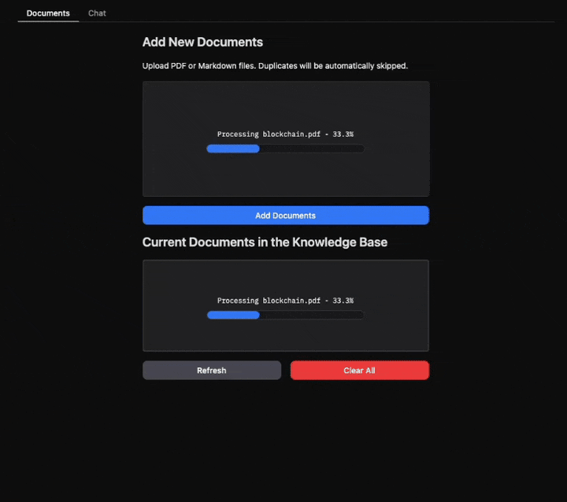

<p align="center">
  
</p>

<h1 align="center">Agentic RAG for Dummies</h1>

<p align="center">
  <strong>使用 LangGraph 构建模块化 Agentic RAG 系统，支持对话记忆、文档检索和问题澄清</strong>
</p>

<p align="center">
  <a href="#项目简介">项目简介</a> •
  <a href="#工作流程">工作流程</a> •
  <a href="#技术栈">技术栈</a> •
  <a href="#快速开始">快速开始</a> •
  <a href="project/README.md">模块化项目指南</a>
</p>

<p align="center">
  
  
  
  
</p>

<p align="center">
  
</p>

## 项目简介

这是一个面向本地文档的 Agentic RAG（检索增强生成）示例项目。用户可以上传 PDF 或 Markdown 文件，建立本地知识库，再通过对话界面向知识库提问。系统会检索文档证据，并由语言模型整理答案。

项目同时包含交互式学习 Notebook 和可运行的模块化应用。若想直接使用应用，请阅读[模块化项目指南](project/README.md)；若想逐步学习 RAG 工作流，可以查看 `notebooks/` 下的示例。

## 主要能力

| 能力 | 说明 |
|---|---|
| 文档管理 | 上传 PDF 或 Markdown，转换、分块并建立索引 |
| 父子分块 | 使用小型子块进行精确检索，再读取较大的父块补充上下文 |
| 混合检索 | 结合稠密向量语义检索和 BM25 稀疏检索 |
| Agent 工作流 | 使用 LangGraph 编排问题改写、检索、工具调用和答案汇总 |
| 对话记忆 | 总结较早的对话内容，支持连续追问 |
| 问题澄清 | 问题存在未解决的指代时，先向用户请求补充信息 |
| 上下文压缩 | 控制多轮检索时的上下文长度 |
| 可观测性与评估 | 可选接入 Langfuse；评估 Notebook 使用 RAGAS |

## 工作流程

```text
上传 PDF / Markdown
        ↓
PDF 转换为 Markdown
        ↓
按标题生成父块，再切分子块
        ↓
稠密向量 + BM25 索引写入本地 Qdrant
        ↓
用户提问 → 对话摘要 → 问题改写 / 澄清
        ↓
Agent 检索证据、按需读取父块并压缩上下文
        ↓
汇总答案并流式显示
```

## 技术栈

| 技术 | 用途 |
|---|---|
| Python | 应用实现语言 |
| Gradio | 文档管理与聊天网页界面 |
| LangChain | 连接语言模型、嵌入模型和检索工具 |
| LangGraph | 编排状态化 Agent 工作流 |
| Ollama | 默认的本地聊天模型运行环境 |
| Qdrant | 本地向量数据库 |
| Hugging Face Embeddings / FastEmbed | 稠密与稀疏向量编码 |
| PyMuPDF4LLM | PDF 转 Markdown |
| Langfuse | 可选的调用链观测 |
| RAGAS | Notebook 中的检索与回答质量评估 |

## 快速开始

### 环境要求

- Python 3.11 或更高版本
- [Ollama](https://ollama.com/) 并确保服务正在运行
- 首次运行需要网络连接，以下载聊天模型和文本嵌入模型

### Windows

在仓库根目录运行：

```powershell
.\start.bat
```

启动脚本会创建 Python 虚拟环境并安装依赖。如果 Ollama 已启动但尚未安装模型，脚本会尝试下载默认模型 `llama3.1:8b`。也可以手动执行：

```powershell
ollama pull llama3.1:8b
```

### Linux / macOS

启动 Ollama 服务后，在仓库根目录运行：

```bash
chmod +x start.sh
./start.sh
```

### 使用应用

启动完成后访问 <http://127.0.0.1:7860>：

1. 在“文档管理”页面上传 PDF 或 Markdown 文件。
2. 点击“添加文档”，等待转换和索引完成。
3. 切换到“对话”页面开始提问。

完整安装说明、配置项、常见问题和 Docker 部署步骤见[模块化项目指南](project/README.md)。

## 模型配置

聊天模型默认使用 Ollama 的 `llama3.1:8b`。可以在 `project/.env` 中设置 `OLLAMA_MODEL` 指定其他模型；该模型须能在当前 Ollama 环境中使用。启动脚本只会在本机还没有任何模型时尝试下载配置的模型。

嵌入模型、检索阈值、分块大小和本地数据目录等配置位于 `project/config.py`。更换嵌入模型后需要清空旧索引并重新导入文档。

## 项目目录

```text
project/
├── app.py                 # 应用入口
├── config.py              # 模型与检索配置
├── document_chunker.py    # 父子分块
├── core/                  # RAG 系统、文档管理、聊天和观测
├── db/                    # Qdrant 与父块存储
├── rag_agent/             # LangGraph 工作流、节点、工具和提示词
└── ui/                    # Gradio 界面

notebooks/                 # 教学、评估和可观测性 Notebook
```

## 本地数据与隐私

文档转换结果、父块内容和 Qdrant 索引默认保存在本地项目目录。运行时仍可能需要联网下载模型；启用 Langfuse 后，相关调用链数据会发送到配置的 Langfuse 服务。请根据自己的隐私和部署要求配置服务。

## 许可证

本项目基于 [MIT License](LICENSE) 发布。
